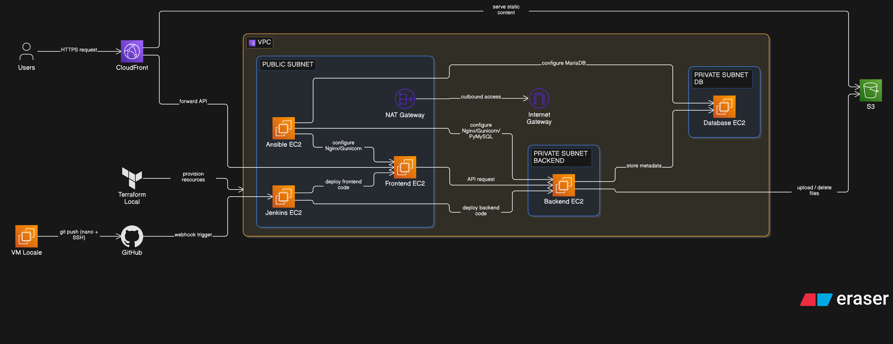

# File Management - Infrastructure AWS 3-Tier

Application web de gestion de fichiers (upload, téléchargement, renommage, suppression) déployée sur une architecture AWS à trois niveaux. L'infrastructure est créée avec Terraform, les serveurs sont configurés avec Ansible, et le code applicatif passe par un pipeline Jenkins (lint, tests, build d'images Docker, déploiement, health check).

Dépôt : github.com/amelachio/file-upload-aws-devops-terraform-ansible-jenkins

## Architecture

Le projet repose sur un VPC (10.0.0.0/16) découpé en trois sous-réseaux :

- Un sous-réseau public contenant le frontend, le serveur Ansible (bastion) et Jenkins
- Un sous-réseau privé pour le backend
- Un sous-réseau privé pour la base de données

Les sous-réseaux privés n'ont aucune exposition directe à internet. L'accès administratif se fait via le serveur Ansible, qui agit comme point d'entrée unique vers le backend et la base de données. Un NAT Gateway donne un accès sortant à ces deux sous-réseaux pour les mises à jour système.

Le flux applicatif : l'utilisateur passe par CloudFront pour atteindre le frontend ; le frontend relaie les requêtes au backend ; le backend stocke les fichiers dans S3 et leurs métadonnées dans MariaDB.

## Stack technique

- Infrastructure : Terraform
- Configuration des serveurs : Ansible, avec Ansible Vault pour les secrets
- CI/CD : Jenkins (Jenkinsfile déclaratif), déclenché par webhook GitHub
- Qualité : pytest (tests), flake8 (lint), Checkov (analyse statique Terraform)
- Conteneurs : Docker (Dockerfile backend et frontend)
- Backend et frontend : Python (Flask, Gunicorn), derrière Nginx
- Base de données : MariaDB
- Stockage : S3, servi via CloudFront
- Supervision : agent CloudWatch et alarme sur l'espace disque de Jenkins

## Pipeline CI/CD

Chaque `git push` sur la branche `main` déclenche le pipeline via un webhook GitHub. Les étapes s'exécutent dans l'ordre ; si l'une échoue, les suivantes ne tournent pas.

1. **Checkout** : récupération du code depuis GitHub
2. **Test** : création d'un environnement virtuel, installation des dépendances figées, `flake8` (style PEP8) puis `pytest` (10 tests, avec S3 et la base simulés par des mocks)
3. **Build Images** : construction des images Docker du backend et du frontend, puis suppression des images pour ne pas remplir le disque de Jenkins. Cette étape valide que les Dockerfiles sont corrects
4. **Deploy Backend** : copie de `app.py` sur le serveur backend par SSH (`sshagent`), puis redémarrage du service
5. **Deploy Frontend** : même principe pour le frontend et ses templates
6. **Health Check** : après une pause de 10 secondes, jusqu'à 5 essais sur `GET /files` (backend) et `GET /` (frontend). Le pipeline échoue si le code HTTP n'est pas 200 au dernier essai

Ce que j'ai vérifié en pratique, pas seulement configuré :

- Un test volontairement cassé fait passer le build au rouge à l'étape Test, puis un `git revert` le remet au vert
- Un health check pointé volontairement sur une URL inexistante (HTTP 404) fait échouer le build après 5 essais, puis un `git revert` le remet au vert
- Le webhook déclenche bien un build à chaque push

## Tests et qualité du code

- `backend/tests/` contient 10 tests : liste des fichiers, renommage (dont la conservation de l'extension) et un test de fumée
- Les dépendances sont figées (`requirements.txt`, `requirements-dev.txt`) pour que le build soit reproductible
- `flake8` est configuré dans `backend/.flake8` (longueur de ligne 120)

## Analyse de sécurité de l'infrastructure (Checkov)

Un scan Checkov sur le dossier Terraform donne 75 contrôles réussis et 51 en échec. J'ai trié les résultats plutôt que de tout corriger à l'aveugle :

- Corrigé : description de chaque règle de security group, accès SSH restreint à mon adresse IP en /32, volume racine de Jenkins agrandi, rôle IAM attaché à l'instance Jenkins
- Rendu explicite : `metadata_options` avec IMDSv2 obligatoire (`http_tokens = "required"`) sur les cinq instances. C'était déjà le comportement par défaut de l'AMI, donc ce changement documente la configuration plutôt qu'il ne corrige une faille
- Accepté pour ce projet de démonstration, car le coût ou la complexité ne se justifient pas : WAF, journaux d'accès CloudFront et S3, réplication inter-régions, chiffrement KMS, VPC flow logs, détection `0.0.0.0/0` sur le port 80 du frontend (voulu, c'est le point d'entrée web)

## Supervision

L'agent CloudWatch est installé sur Jenkins par Ansible. Il publie la métrique `disk_used_percent` dans l'espace de noms `CWAgent`. Une alarme Terraform (`3tier-jenkins-disk-above-80`) passe en alerte au-dessus de 80 % d'utilisation du disque. Cette alarme est née d'un vrai problème : le disque de 8 Go de Jenkins se remplissait, et le volume a été agrandi à 12 Go.

## Docker

Les Dockerfiles du backend et du frontend (`python:3.12-slim`, Gunicorn) sont dans `backend/` et `frontend/`, avec un `.dockerignore`. Ils sont construits à chaque build Jenkins pour garantir qu'ils fonctionnent, et ils ont été testés localement en lançant les conteneurs avec la configuration montée en volume.

Le déploiement en production reste fait avec systemd sur les instances EC2 (voir limites ci-dessous).

## Sécurité

Le backend accède à S3 via un rôle IAM attaché à l'instance, sans clé d'accès dans le code. Les security groups suivent une logique de liste blanche : le backend et la base de données n'acceptent du trafic que depuis les sources explicitement autorisées. L'accès SSH aux serveurs administrables (frontend, Ansible, Jenkins) est limité à mon adresse IP. Les identifiants de la base de données sont chiffrés avec Ansible Vault. Les requêtes SQL utilisent des paramètres liés pour éviter les injections.

## Déploiement initial

1. `terraform plan` puis `terraform apply` créent le réseau, les instances, les rôles IAM, S3, CloudFront et l'alarme CloudWatch
2. Le playbook Ansible `ansible/playbooks/setup.yml`, lancé depuis le serveur Ansible, configure les serveurs : paquets, Nginx, MariaDB, Jenkins, Docker, agent CloudWatch
3. Jenkins déploie ensuite le code applicatif à chaque push

## Fonctionnalités

- `POST /upload` — envoi d'un fichier (image ou PDF)
- `GET /files` — liste des fichiers avec leurs métadonnées
- `PUT /files/<id>` — renommage
- `DELETE /files/<id>` — suppression

Le frontend ajoute une interface pour ces actions, avec téléchargement direct, renommage en un clic et confirmation avant suppression.

## Problèmes réels rencontrés

- Une configuration réseau empêchait la base de données d'accepter des connexions distantes
- Une politique IAM incomplète, découverte en testant la suppression de fichiers
- Un security group trop permissif a attiré des tentatives de connexion SSH automatisées, au point de perturber les déploiements : accès restreint à une seule IP
- Jenkins manquait d'espace disque : volume agrandi et alarme CloudWatch ajoutée
- Jenkins est tombé en `start-limit-hit` après un redémarrage : récupération avec `systemctl reset-failed` puis `start`

Chaque cas a demandé de diagnostiquer la cause avant de corriger, et de vérifier que la correction tenait.

## Limites connues

- Le déploiement n'utilise pas les conteneurs : les images sont seulement construites pour validation. Une évolution naturelle serait un registre (ECR) et un déploiement des conteneurs avec ECS en type de lancement EC2, qui réutilise les instances déjà gérées par le projet
- Les conteneurs tournent en root (pas de `USER` non privilégié dans les Dockerfiles)
- Pas de rollback automatique : en cas d'échec du health check, je corrige avec `git revert`
- Les tests ne couvrent pas `POST /upload` ni `DELETE`
- L'alarme CloudWatch n'envoie pas encore de notification (pas de sujet SNS)
- Pas de HTTPS sur le frontend et le backend
- L'adresse IP autorisée en SSH est écrite dans le code Terraform et doit être mise à jour quand elle change
- Le compte Terraform a un accès administrateur
- Le renommage ne modifie pas l'objet dans S3, seulement son nom affiché

## Améliorations possibles

- Notification SNS par e-mail pour l'alarme
- Registre ECR et déploiement par conteneurs avec ECS en type de lancement EC2 (cluster ECS sur les instances existantes, l'étape de build pousse l'image dans ECR et met à jour le service)
- Utilisateur non root dans les Dockerfiles
- Rollback automatique en cas d'échec du health check
- WAF devant CloudFront, HTTPS sur les services
- Secrets dans AWS Secrets Manager
- Politique IAM du compte Terraform réduite au strict nécessaire

## Auteur

Anicet Melachio
Ingénieur Infrastructure - Maîtrise en cybersécurité, Université de Sherbrooke
